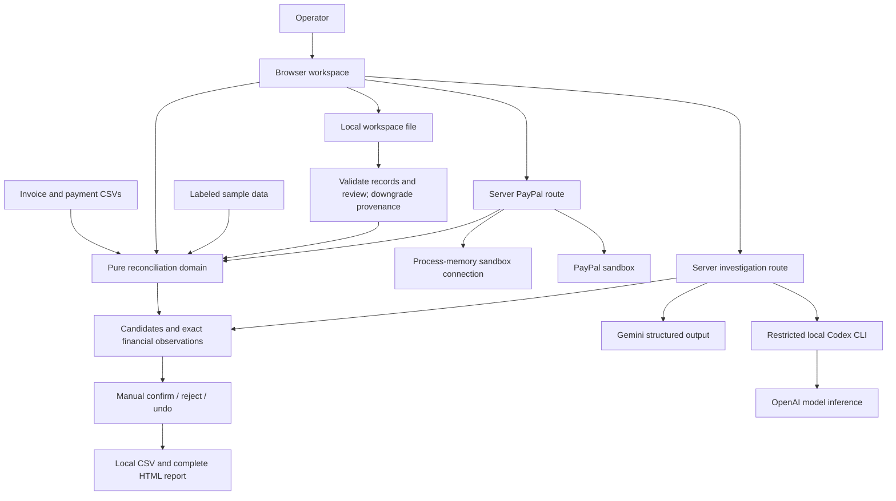
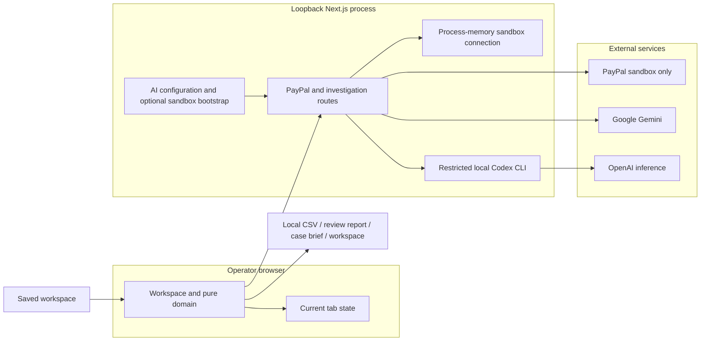

# Paper Ledger | Architecture and Judge Setup

**Source: [Smokeybear10/paper-ledger](https://github.com/Smokeybear10/paper-ledger)**

Paper Ledger reconciles invoice balances with PayPal receipt evidence and explicit human review.
The r4 workflow moves AI evidence preparation into one focused dialog while preserving provider-bound consent, original investigation scope and human authority. Its 36-file clean install/typecheck/build, dialog checks, real Codex sample flow and 13 downloaded-export checks passed. The 12-case HTTP/Codex regression, actual $1.00 capture/review/export workflow and separate reporting check ran on r3; financial calculations and server adapters remain unchanged in the r4.1 publication snapshot. The intentional r4 restart cleared the process-memory PayPal connection, and no new PayPal read is claimed. This document describes the approved r4.1 source; demo and competition-entry status are tracked below.
Updated November 6, 2026.

**Version scope:** This document describes the r4.1 publication snapshot of the r4 application, following baseline [58c6e9b](https://github.com/Smokeybear10/paper-ledger/tree/58c6e9b). It includes the evidence-map/report views, Activity import, manual association, explicit invoice scope, sandbox onboarding and focused AI dialog, plus the warning-visibility correction recorded below. Verification retains its evaluated r3/r4 snapshot labels.

Judge entry points: [clean-machine setup](#judge-quick-start), [sample review](#try-the-sample-and-review-workflow), [submission draft](#6-competition-entry-draft), [source-package plan](#public-source-package-plan).

## Judge quick start

Use the following commands to clone and run the repository. The 36-file r4 clean source copy passed `npm ci`, typecheck and production build. Its canonical production UI passed a fresh real Codex sample investigation, manual confirmation and 13 downloaded-export checks. The r4.1 publication stage also passed typecheck/build and the targeted checks below. The 12-case real HTTP/Codex regression ran on r3; financial calculations and server adapters remain unchanged. Earlier checks and version limits are distinguished below. Other operating systems have not been rehearsed.

```sh
git clone https://github.com/Smokeybear10/paper-ledger.git paypal-reconciliation
cd paypal-reconciliation
npm ci
cp .env.example .env.local
npm run build
npm run start
```

Open [http://127.0.0.1:3107/](http://127.0.0.1:3107/). Keep that exact origin; do not change the port or expose it through a public tunnel. The server boundary permits local browser requests on port 3107. Stop the server with Ctrl+C. `npm run dev` is the development alternative; `npm run typecheck` is available after Next has generated its build types.

Blank credentials support the synthetic sample, CSV import, exact matching, evidence map, decision-impact preview, manual review, complete HTML review report, CSV export and local workspace save/open. They do not simulate a successful PayPal or AI call. There is no database, migration, cloud account or background service to initialize.

### Try the sample and review workflow

These steps describe the r4 workflow retained in the r4.1 source snapshot.

1. Choose **Load sample ledger**. The six invoices and six payment/event rows are synthetic and initially unreviewed. **Review progress** starts at zero covered invoices, four eligible unallocated receipts / $2,090 original gross, $325 pending and −$60 signed adjustments. These are loaded-record totals; gross is counted once and is not available cash.
2. Open **INV-4107** from the competing-invoices finding. Queue navigation preserves that finding’s receipt context. Compare PAY701 against the two $500 invoices for Morgan Studio / C07: INV-4107 is **November event retainer**; INV-4108 is **Remaining October event balance**. The comparison and source fields keep provenance, the original note, $500 gross, $17.94 fee and $482.06 net distinct. **Relationship trace** opens the optional evidence map; inspecting a node does not navigate until its explicit **Open invoice** action is chosen.
3. Choose **Interpret payment note** to open **Review AI evidence**, a focused native dialog. If AI is unavailable, continue with manual review in step 4. **Use displayed evidence for review** copies the note and descriptions into editable drafts; this does not send them or approve consent. The note says “This is the retainer for the November event, not the remaining October balance.” Review/redact the excerpt and each optional **Context for INV-…** field, acknowledge the named provider destination and complete packet, then choose **Investigate with AI**. Scope and editors scroll internally above the approval footer. Closing and reopening the same context preserves redactions and same-provider approval; editing evidence revokes approval. Valid dispatch closes the dialog and focuses **Cancel** while the investigation runs. Imported descriptions are never automatically uploaded, and opening preparation does not trigger inference.
4. Inspect the quoted remittance, approved target-context quote and citations. A supported live interpretation remains unconfirmed; historical AI never becomes a new live suggestion. Context is operator-provided, not a PayPal-verified invoice reference. Use **Review decision** to reach the association controls. **If you confirm** previews confirmed gross $0 → $500, eligible gross awaiting allocation $2,090 → $1,590 and the competing invoice that would lose this receipt. Add an optional decision note, then choose **Confirm INV-4107**. The model does not make that decision. INV-4108 loses PAY701 and review progress changes. The human decision appears first; retained AI appears below it in the past tense, with its original evidence scope. The optional trace marks the edge **Human confirmed**. Undo releases the receipt and removes its frozen model evidence.
5. Inspect INV-4105’s $600 partial candidate against $960 due, INV-4106’s $325 pending event, and INV-4109’s $240 original receipt with a −$60 linked refund. Click a payment ID in the work queue or **Receipts** ledger to open **Payment record**: full note, signed gross, fee/net unknown states, references, provenance and candidate/confirmed invoice relationships. Explicit **Linked source records** connect a TXN reference with its provider transaction ID; follow them without allocating either record. Related-invoice actions deliberately open review. Pending cannot establish settled coverage; a linked refund prevents a simple covered conclusion, and unallocated unsupported events remain inspectable.
6. Choose the header’s **Review report** to download standalone HTML covering all loaded invoices, all payment/adjustment records, open findings, human decisions, retained pre-decision AI and both source scopes. It does not require a selected invoice. Unapplied AI investigations are excluded from this complete report. **Download evidence brief** remains the selected-case export and may include a current validated investigation. **Export CSV** includes invoice descriptions, unresolved states and decision notes; suggestions stay outside confirmed totals.
7. Choose **Workspace → Save workspace**. After refresh, open the saved JSON, inspect its preview and choose **Restore records and decisions**. Descriptions, records, manual decisions and revisions restore with unverified file provenance. AI responses, approved sending drafts and frozen model evidence do not restore; save the report/evidence HTML separately.
8. Use `public/samples/invoices.csv` and `public/samples/payments.csv` through **Import files** to exercise mapping, including optional invoice description. Explicitly apply each validated replacement. It preserves the other collection, clears previous review/AI and leaves current work intact on invalid input.
9. `public/samples/paypal-activity.csv` is a separate synthetic English US Activity-header fixture. Import it as **Payments**, inspect the detected-format notes and row/status preview, then explicitly replace the payment source. Recognized headers do not authenticate the file.

**Original invoice fields** and **Original payment fields** expose the retained source names and exact values; normalized fallback fields are labeled separately. Open the disclosure to search complete names or values, including later fields, in pages of 20 with exact filtered/total counts. Closing it removes field rows from the rendered view. Empty strings show **Not supplied**, while supplied line breaks and spacing are preserved; text is escaped without truncation or a copy action.

For a payment missed by deterministic matching, use **Find another receipt** in the invoice's receipt section. Search the complete eligible unallocated collection by ID, payer, memo or amount, in pages of 12. Selection opens evidence for review and does not allocate it. Receipts explicitly referencing a different invoice are disabled; missing payer IDs are not presented as a customer match. Record the required supporting reason for a manual association before confirming. Multiple distinct completed receipts may cover one invoice, including successive $60 and $40 installments against $100 due; existing confirmations are counted once. Excess confirmed gross remains an overpayment, and one receipt cannot cover two invoices.

All qualifying deterministic candidates remain available across the loaded collections, up to 1,000 invoices and 1,000 payments. **Search candidate invoices** and **Search receipt candidates** search complete candidate lists, rendered in pages of 20. The evidence map shows at most four invoice nodes, with the selected invoice, confirmed owner and supported live interpretation prioritized. Its exact relationship count and **Compare all … invoices** action expose the complete comparison; the four-node view is a presentation bound, not a candidate cutoff. Search/pagination do not change matching or AI scope. **Investigation scope** explicitly selects 1–20 related invoices, always including the current invoice, without rejecting excluded candidates. With more than 20 candidates, a selection is required before inference. The packet, interpretation and exported AI evidence disclose included/excluded counts. The selected receipt and all linked adjustments must still fit the 20-payment bound; no adjustments are silently dropped. A manually selected receipt without a matching rule stays a manual-review case.

The r3 authenticated PayPal path traversed capture lookup, normalization, candidate evidence, manual review and export for one authorized $1.00 sandbox receipt. This goes beyond token authentication or an isolated lookup, while remaining a single controlled functional test of the backend retained in r4.

### Enable one AI provider

The bridge uses this pinned public npm CLI build. The r3 real-HTTP API regression and fresh r4 production-UI sample flow passed with Codex. The provider uses normal operator authentication, without copying credentials into the source package. Install it and sign in on the judge's own machine:

```sh
npm install --global @openai/codex@0.166.0-alpha.5.1
codex --version
codex login
```

Then edit these existing `.env.local` entries and restart Paper Ledger:

```dotenv
AI_PROVIDER=codex
CODEX_BIN=codex
```

The bridge was verified with that CLI version; it uses specific non-interactive capability flags, so a different CLI version must be checked before promising compatibility. If `codex` is not on the Node server's PATH, set CODEX_BIN to its local absolute executable path. Do not copy the developer's path or authentication files. CODEX_MODEL is optional; when unset, the response identifies `codex-cli-default`, not a proven underlying model ID. Use the actual provider/model label from the recorded run in the final submission.

The normal Codex sign-in flow requires an account with model access and available usage. Paper Ledger does not distribute an authenticated account. Installation and sign-in behavior are described in the [official OpenAI Codex CLI documentation](https://learn.chatgpt.com/docs/codex/cli).

The portable alternative is the implemented Gemini adapter:

```dotenv
AI_PROVIDER=gemini
GEMINI_API_KEY=your_local_key
GEMINI_MODEL=gemini-3.5-flash-lite
```

A working key, model access and quota are required. The Gemini network path has not yet been verified against a real account; the default model name is configuration, not a claim of access. Do not publish `.env.local`, API keys or CLI credentials. Configuration badges mean configured, not authenticated or successfully evaluated.

### Enable PayPal sandbox reads

For **Reporting window**, enable **Transaction search** in the app's Sandbox settings and choose **Save Changes** before initial authentication. An existing token/session may not reflect added permissions; fresh authentication does not guarantee immediate PayPal permission propagation.

Open **PayPal sandbox** and enter the **Client ID** and **Secret** for your own sandbox app from PayPal Developer → Apps & Credentials → Sandbox. These are app credentials, never your PayPal email or account password. Choose **Authenticate sandbox app**. No `.env` edit or restart is needed. The inputs clear on submission or dialog close; credentials and tokens are held by the local server process and excluded from workspace files, exports and browser storage.

Optional `PAYPAL_CLIENT_ID` and `PAYPAL_CLIENT_SECRET` environment entries initialize the connection once when the process first handles connection status or use. That state is **configured**, not authenticated, until OAuth succeeds. **Disconnect sandbox** clears the active session and disables environment fallback until restart or explicit connection. A failed replacement leaves the previous connection active. This is one local operator's process session, not third-party merchant OAuth or a multi-user credential vault.

Use **PayPal sandbox → Known capture** with an authorized capture ID, or **Reporting window** with explicit UTC dates. The reporting window is at most 31 days and 1,000 records; reporting can lag recent activity. A permission denial is a real connector error. The app never substitutes sample data for an unsuccessful API call.

The app reads existing sandbox transactions; it does not create a checkout or money movement to seed an account. Prepare one authorized completed USD capture outside the app, and one invoice CSV row whose amount and reference reflect the intended demonstration. Keep that invoice's file provenance distinct from the authenticated receipt.

The verified r3 test used a separately authorized temporary QA broker outside Paper Ledger to create one $1.00 sandbox checkout. An existing personal sandbox buyer approved it on PayPal's sandbox site, and one explicit capture completed. Paper Ledger then imported one synthetic invoice CSV, fetched the owned capture through **Known capture**, applied its replacement preview, inspected provenance and recorded a manual reason/confirmation before downloading case/full HTML and CSV. Returned gross was **$1.00**, fee cost **$0.52** and net **$0.48**; confirmed invoice gross became **$1.00**, with **$0.00** unallocated. The invoice stayed an unverified imported file; only the returned receipt was a verified sandbox observation, with one-capture coverage and an inspected provider merchant identity. No AI was run on this receipt because it had no remittance text; the language-investigation checks use separate synthetic cases.

Reporting is a separate permission path. The earlier r3 Nov 1–Nov 6 reporting request returned access denied, and Transaction search was subsequently enabled and saved. After fresh same-app OAuth, the r3 main app successfully read the completed Nov 1–Nov 5 UTC window with HTTP 200. One returned T1900 event was conservatively retained as **other / unsupported**, with unknown fee/net. Those reporting records were not applied; the reviewed capture workspace stayed intact. This establishes authorization for that bounded query, not every event mapping, recent-transaction visibility, immediate permission propagation or complete account history.

Financial calculations and server adapters remain unchanged in r4.1. The intentional r4 restart cleared the memory-only connection; the last reviewed session was disconnected and the Developer login had expired. A new read requires the operator to authenticate their own sandbox app again. Historical authenticated observations do not imply an active connection, and no new r4/r4.1 PayPal read is claimed.

A returned source preview requires **Apply sandbox replacement**. A fresh status check rejects a preview from a disconnected or replaced connection. Applying replaces the entire payment collection and clears previous decisions/AI while retaining invoices. Disconnecting preserves already-applied records as historical observations. Inspect **Sources** for requested range, observed range, filters, actual returned account identity and fetch time. One capture is one observation; a fully fetched query window is not complete account history. OAuth success alone verifies no loaded records and does not establish reporting permissions.

## 1. System overview

A local Next.js application keeps the current invoice/payment dataset and review decisions in browser memory.
The operator can explicitly save a versioned local workspace file and preview a validated restore. No automatic or server-side ledger storage is used.
A pure TypeScript domain module validates money, normalizes rows, proposes candidates and applies reviewed allocations.
Two server routes make bounded read-only PayPal sandbox calls and structured AI investigations through Gemini or a restricted authenticated local Codex CLI.
AI configuration remains in the server environment or the operator's normal CLI credential manager. Sandbox app credentials and tokens live in a private process-memory session, optionally initialized once from the environment. No database, account system or background workers are required.



Boundaries:
- Files, network responses and model output are untrusted.
- Provider provenance applies only to returned API observations.
- Model proposals and human confirmation do not upgrade provenance.
- Only confirmed allocations affect confirmed gross-coverage totals.

## 2. Components

These are the implemented component locations.

| Component | Purpose | Owns | Depends on | Lives in |
|---|---|---|---|---|
| App shell | Server-rendered entry and initial AI configuration | Initial shell; no secrets in props; PayPal status is queried dynamically | Workspace | app/page.tsx, app/layout.tsx |
| Workspace | Import preview, ledger, selected case and review | Current dataset, revisions, active requests and decisions | Domain and server routes | app/workspace.tsx |
| Product styles | Ledger, evidence and responsive states | Visual presentation | App shell and workspace | app/globals.css |
| Reconciliation domain | Types/schemas, CSV normalization, money, candidates, review and export | Pure financial and state transitions | Zod and CSV parser | lib/reconciliation.ts |
| Shared contracts | Canonical types and boundary schemas | Validated data shapes | Zod | lib/contracts.ts |
| Local server boundary | Enforce loopback Host/Origin, bounded JSON and sanitized errors | Shared request policy for both routes | Native Web APIs | lib/server-boundary.ts |
| Sample ledger | Reproducible, explicitly synthetic cases | Fixture records | Domain types | lib/sample-data.ts |
| PayPal adapter | Connection status/connect/disconnect, OAuth, capture/report reads and normalization | Versioned process-memory session, token cache and connection-bound requests | Fixed PayPal sandbox endpoints; boundary schemas | app/api/paypal/route.ts |
| AI adapter | Recompute evidence, enforce approved provider, validate semantic proposals | Separate required provider envelope, server configuration and model response validation | Gemini or local Codex bridge; API/domain schemas | app/api/investigate/route.ts |
| Codex bridge | Bounded text-only local CLI invocation | Private temporary files, process cancellation, concurrency and output limits | Installed authenticated Codex CLI | lib/codex-inference.ts |
| Investigation desk | Receipt-centered exception grouping and exact decision previews | Derived findings and noncommitting allocation simulation | Validated domain | lib/case-intelligence.ts, app/investigation-desk.tsx |
| Evidence map | Bounded visual trace from a source record to invoice relationships | Up to four inspected nodes, explicit source/AI/human states and access to full comparison | Dataset, reconciliation and validated investigation | app/evidence-map.tsx |
| Candidate comparison | Complete searchable and paginated receipt/invoice relationships | Presentation of gross/reference/customer/eligibility and live selection | Reconciliation result and shared contracts | app/case-comparison.tsx |
| Payment record inspector | Open queue/receipt IDs without allocating or sending evidence | Inspected record ID, explicit TXN-linked source navigation and deliberate invoice-review navigation | Current payment collection and reused candidate comparison | app/workspace.tsx, app/case-comparison.tsx |
| Source fields | Search original invoice/payment fields or labeled normalized fallback | Native disclosure, memoized entries, open-only filtering and 20-field pages | Record fields supplied by the workspace | app/source-fields.tsx |
| Manual receipt picker | Search eligible unallocated receipts beyond deterministic candidates | Pages of 12, foreign-reference guard and explicit review selection | Current invoice, records and reconciliation | app/receipt-picker.tsx |
| Investigation scope | Explicitly select related invoices for bounded AI input | Required current invoice, 20-invoice limit and included/excluded counts | Current receipt relationships | app/invoice-scope.tsx |
| Review overview and impact | Loaded-record progress and exact before/after allocation effect | Coverage, distinct unallocated gross and noncommitting decision preview | Reconciliation and association preview | app/review-impact.tsx, lib/review-impact.ts |
| Evidence exports | Complete review report and selected-case evidence brief | Escaped standalone HTML; current human decisions, source scopes and validated frozen evidence | Domain and shared contracts | lib/evidence-brief.ts |
| Workspace file | Bounded versioned save/restore of records and manual review | Validation, financial/review invariants and unverified restored sources | Shared schemas and reconciliation domain | lib/workspace-file.ts |

Use a small number of cohesive functions/modules; split a large domain module only when its concerns warrant it.
Avoid a second backend, generic agent framework or speculative service classes.

## 3. Request lifecycles

Timing labels below are design targets, not passed performance guarantees. The dense-graph measurements in the verification section describe a single local stress run.

### Import and reconciliation — target: under 1 second for bounded collections

```mermaid
sequenceDiagram
  participant U as Operator
  participant W as Workspace
  participant D as Pure domain
  U->>W: Select CSV and mapping
  W->>D: Validate bytes, headers, rows and money
  D-->>W: Preview or row errors
  U->>W: Apply collection replacement
  W->>W: Increment dataset revision; clear decisions and AI
  W->>D: Build candidates and exact observations
  D-->>W: Ledger and unresolved exceptions
```

Invoice replacement preserves payments; payment replacement preserves invoices.
There is one active payment source. CSV and sandbox imports replace it rather than append.
Invalid/conflicting imports preserve the current dataset.
Source rows and unsupported-event counts remain inspectable. An invoice may carry an optional description of at most 500 characters; it survives CSV import, workspace save/open and CSV/HTML export. It remains imported context, not an authenticated PayPal observation.

Payment import recognizes a conservative English US Activity header set: Date, Time, TimeZone, Type, Status, Currency, Gross, Fee, Net and Transaction ID. It combines supplied US dates and times only with supported US zone abbreviations, UTC/GMT or numeric offsets; it does not invent a missing clock or infer the merchant's locale. A detected-format panel exposes the normalization convention. Activity Fee signs are accepted only when supplied Gross/Fee/Net prove an exact bridge; a nonzero Fee without Net is a correction error. Explicit normalized fee-cost mappings retain their signed-cost convention, and missing components remain unknown.

Memo balance-impact rows, unknown directions and directions incompatible with a known receipt/adjustment remain unsupported records. Unknown events and invoice-only statuses cannot establish settled coverage. Conflicting nonempty invoice-reference columns require explicit mapping. Related transaction IDs preserve their relation type. This supports the documented Activity subset, not every locale or other PayPal report format, and it never authenticates a CSV. [PayPal Activity download fields](https://developer.paypal.com/reports/activity-download/)

### Selection, filtering and review — target: under 100ms locally

```mermaid
sequenceDiagram
  participant U as Operator
  participant W as Workspace
  participant D as Pure domain
  U->>W: Select or filter a result
  W->>D: Read local candidates and observations
  D-->>W: Evidence panel
  U->>W: Inspect payment event or explicit TXN-linked record
  W-->>U: Full source facts; no allocation or evidence sending
  U->>W: Confirm / reject / undo
  W->>D: Validate available receipts and apply decision
  D-->>W: New confirmed allocations and candidate availability
  W->>W: Increment review revision; invalidate old analysis
```

The investigation view starts with compact loaded-record progress and a filtered work queue. The selected invoice puts receipt/candidate comparison beside the human decision; **Interpret payment note** opens **Review AI evidence**, and **Review decision** jumps to the association controls. The side panel keeps a compact scope summary and reopening action rather than duplicate editors. One native dialog, at most 760 px wide, contains the single scope selector, remittance editor and invoice-context editors. Its evidence region scrolls internally while the approval footer stays available. Opening focuses the dialog title; closing restores the enabled opener. Validated dispatch closes the dialog and focuses the pending investigation's **Cancel** action. Closing/reopening the same context preserves redactions and same-provider approval; evidence edits revoke it. Opening never grants consent or triggers inference.

Queue links carry their finding's preferred receipt so another finding for the same invoice cannot silently select the wrong payment. Reopening the same invoice with no change to its preferred receipt context preserves drafts and consent; changing case context clears stale sending drafts/consent. The optional **Relationship trace** distinguishes unconfirmed candidates, validated live AI interpretations, ineligible evidence and confirmed human associations. Inspecting a map node does not navigate or allocate; an explicit action opens another invoice. At most four nodes render, and the complete comparison remains searchable in pages of 20. Navigation rechecks current relationships and eligibility. Before confirmation, exact impact shows confirmed gross, unique eligible unallocated gross, remaining amount and affected competing invoices. The human decision precedes retained AI, which uses past-tense wording and its original evidence counts; technical citations, source fields and calculation detail use disclosures.

Clickable payment IDs in the queue and receipt ledger open a read-only record dialog, including pending, refund and unsupported events. It reuses the candidate comparison for the full note, money bridge, source facts and related invoices. Explicit TXN references link source records in either direction and are paged in groups of 12; an order/subscription ID is not treated as a transaction link. Following a source link only changes the inspected record. Opening a related invoice is a separate deliberate navigation into the normal review flow; neither action confirms a receipt, changes a rejection, sends AI evidence or upgrades provenance.

The workspace memoizes reconciliation for the current dataset/review and passes that result into desk derivation, association preview and review impact instead of repeatedly deriving the same current graph. A proposed decision still computes its own simulated after-state. Queue evidence-ID chips mount only when the finding's details open. `SourceFields` memoizes source entries, filters only while open and renders at most 20 exact name/value rows; changing the record or dataset keys a new disclosure. These are implementation bounds and reuse mechanisms, not a measured latency promise.

One receipt cannot be confirmed for two invoices.
Manual review can associate an eligible unallocated receipt without a customer/reference match, with a required supporting note in the interface; an explicit reference to another invoice cannot be overridden. Selecting a receipt is a draft, not a financial decision. Multiple receipts may be confirmed successively against one invoice; duplicate IDs and existing confirmations are counted once, and excess gross remains overpayment. Pending, unsupported and nonpositive receipts remain ineligible. Linked adjustments and unrelated candidates do not contaminate a different confirmed owner's invoice status.
Suggested coverage and confirmed allocations are different fields.
Fees do not reduce invoice gross coverage.
Refunded or reversed receipts remain explicit exceptions.
Render a bounded page of ledger rows; do not put network requests on this path.

### AI investigation — immediate progress, bounded remote request

```mermaid
sequenceDiagram
  participant U as Operator
  participant W as Workspace
  participant A as Investigation route
  participant G as Selected AI provider
  U->>W: Select invoice scope; preview/redact excerpt and context
  W->>W: Bind approval to provider; capture request ID and fingerprint
  W->>A: Bounded domain case plus approved-provider API envelope
  A->>A: Enforce local request boundary and recompute facts
  A->>A: Reject provider mismatch before dispatch
  A->>G: Bounded structured semantic request; no payment tools
  G-->>A: Completed structured response or named error
  A->>A: Validate IDs, citations and exact note/context quotes
  A-->>W: Semantic proposal and deterministic observation IDs
  W->>W: Recompute current fingerprint and request identity
  alt Current request and case
    W-->>U: Reviewable interpretation with cited evidence
  else Changed data, decision, selection, excerpt or context
    W->>W: Discard stale result
  end
```

The fingerprint covers dataset/review revisions, selected case, scoped invoice and receipt IDs, scope counts, allocations, previewed excerpt and every approved per-invoice context string. Editing scope or sending context invalidates stale results and consent without editing imported data. Context belonging to excluded invoices is removed from sending drafts. Replacing description source data follows normal collection replacement. A sending context is at most 500 characters per invoice; the remittance excerpt is at most 1,200 characters.

Browser consent is bound to the displayed configured provider; an unavailable provider cannot receive advance approval. Every investigation API request requires `expectedProvider` (`codex` or `gemini`) in a separate transport envelope. The route destructures it out of the domain input, compares it with active server configuration and rejects a mismatch with HTTP 409 before provider dispatch. It is not included in the model evidence or financial fingerprint. The browser also checks the returned provider; a mismatch clears approval and no proposal is accepted. Reload/review the destination before approving a changed provider.
A newer request ID invalidates an older request even if its content matches.
Aborting a request is best effort; reducer acceptance checks enforce correctness.
Financial amounts displayed beside a proposal come from deterministic code.
The model proposes an interpreted reference and exact quoted evidence, never an allocation action. If it uses invoice context, `contextQuote` must be an exact nonempty substring of the proposed invoice's approved context and cite `context:<invoice ID>`; unrelated context citations are rejected. Optional imported descriptions are copied only by the operator into editable sending drafts. Empty/unapproved fields are not automatically shared.

The deterministic graph is not capped at the AI bound. The operator may explicitly select 1–20 related invoices, including the current invoice, without altering allocations or rejecting other candidates. If a subset is selected, the packet supplies total/excluded counts, the model is instructed to limit its interpretation, and the UI and exported AI evidence show that limitation. Without a valid explicit scope, more than 20 related invoices blocks inference with the actual count. The selected receipt plus all linked adjustments must fit the 20-payment limit; adjustments are never sliced away. Manual review remains available, and search/page filters never silently change scope.
Gemini requests use store:false. Local Codex uses ephemeral CLI execution with command execution, browser/computer access, connectors, hooks and delegation disabled, and no inherited user configuration. The same quote/ID/arithmetic validation follows both providers. Codex requests are serialized, capped at 60 seconds and 512 KB of output; cancellation waits for the child to close before releasing the slot. No provider-side zero-retention claim is made.
A validated proposal and its approved invoice context can be frozen with the actual subsequent decision timestamp and dataset/review revision. Original scope counts are recovered from the validated recorded input, not recomputed from candidate availability after ownership changes: an investigation of two of 25 invoices keeps two supplied and 23 excluded after confirmation. Frozen evidence appears below the human decision as **Suggested**, **Evidence was ambiguous**, or **No supported association was found**, without a live next-step prompt. The same original subset limitation survives case/full HTML export. It is removed on undo/source replacement and remains separate from current AI analysis. A quoted context is unverified operator input, not accounting approval or provider verification.

### Sandbox import — immediate progress, complete bounded result before replacement

```mermaid
sequenceDiagram
  participant U as Operator
  participant W as Workspace
  participant P as PayPal route
  participant S as PayPal sandbox
  U->>W: Enter own sandbox app credentials
  W->>P: Connect; transient credentials
  P->>P: Enforce local request boundary
  P->>S: Fixed sandbox OAuth endpoint
  S-->>P: Validated token or named error
  P->>P: Atomically install newest successful connection
  P-->>W: Safe status and opaque connection ID
  U->>W: Request capture or bounded reporting window
  W->>P: Typed parameters and connection ID
  P->>P: Bind read and refresh to current connection
  loop Each required reporting page, or one capture lookup
    P->>S: Fixed read-only sandbox endpoint
    S-->>P: Provider response
    P->>P: Validate and normalize; check limits and totals
  end
  P-->>W: Records, provenance, coverage and connection ID
  W->>W: Reject stale dataset or connection response
  W-->>U: Replacement preview
  U->>W: Apply source replacement
  W->>P: Fresh connection-status check
  P-->>W: Current connection ID
  W->>W: Clear decisions and old AI; run same reconciliation domain
```

Capture lookup replaces the active payment collection with that record; it does not append a duplicate.
Reporting uses explicit dates, all pages and balance_affecting_records_only=Y.
Failed, inconsistent or over-limit requests do not replace the current collection.
The reporting adapter recognizes positive incoming USD T0000 General Payment and T0006 Express Checkout records, with only supported completed receipts eligible for allocation; the capture adapter uses its separate CAPTURE mapping. Pending, refund, reversal and unsupported events remain explicit. These mappings have contract checks; actual merchant access is not established by those checks.
A completely fetched query window is not lifetime account coverage.
The same POST route accepts strict status/connect/disconnect operations. Its namespaced versioned store lives in one Node process. Candidate credentials are authenticated before atomic installation; only the newest attempt may install, and failure preserves the prior connection. Replacement/disconnect abort old reads and refreshes. OAuth completion, every report page and final responses recheck connection identity, preventing late token-cache writes and cross-connection results. Successful reads carry an opaque connection ID outside source/account identity; the UI binds previews to that ID and dataset revision, then checks status again before application. Already-applied records remain historical observations after disconnect; restoring a workspace clears the transient connection attribution. No credentials or tokens enter source metadata, saved files or responses.

### Export — local operation

Export confirmed allocations, separately named suggestions, source IDs, fee/null state and coverage.
Escape user-controlled formula prefixes and quote CSV fields correctly.
The header’s complete review report uses `buildReviewReport` to derive all loaded invoice/payment rows, open findings, current human decisions, validated retained pre-decision AI and source coverage. It works independently of the selected case and excludes unapplied investigations. The selected-case brief uses `buildCaseBrief` and can include current validated investigation evidence and a clearly labeled manually selected draft receipt; a draft is never exported as a confirmed allocation. Both escape untrusted text, use a standalone no-script CSP and preserve source timestamps; neither is a durable audit log. The report does not establish account completeness or that an unmatched invoice is unpaid.
No export request reaches a provider or accounting system.

### Save and restore — local files

The Workspace dialog downloads a versioned JSON file containing normalized records, original row fields, manual decisions/notes, revisions and selection. It excludes AI responses, frozen model evidence, credentials and active requests. The separate complete review report or selected-case evidence brief preserves retained model analysis from a reviewed decision.

Opening a workspace validates actual UTF-8 bytes (16 MiB maximum), schemas, calendar dates, exact money, unique provider observations and all manual allocation/rejection rules. A preview shows record/decision counts before explicit replacement. Invalid files preserve the active dataset and draft notes. Restored source labels identify a workspace file; provider verification, fetched-account identity and original query-completeness claims are discarded. Observed ranges are derived again from the restored records. Saved decisions are operator-managed claims, not an authenticated audit log.

Restore preserves validated dataset/review revisions and decision timestamps, invalidates all pending request identities and file reads, synchronously replaces the current snapshot, and clears current/frozen AI. A late response cannot apply even if the restored revisions match an earlier workspace.

## 4. State topology

| State | Logical home | Physical home | Lifetime | Failure mode |
|---|---|---|---|---|
| Invoices and payments | Browser memory | Workspace dataset state | Current tab | Reopen an explicitly saved workspace after refresh |
| Original source evidence | Browser memory | Normalized record provenance | Dataset | Unverified/missing fields remain explicit |
| Dataset revision | Browser memory | Workspace revision counter | Current tab | Old request/result cannot apply |
| Confirmations and rejections | Browser memory | Review state keyed by record IDs | Dataset | Cleared on source replacement |
| Review revision | Browser memory | Review state counter | Dataset | Pending AI invalidated after review/undo |
| Selection/filter/page | Browser memory | Workspace view state | Current tab | Fall back to all results |
| Read-only payment inspector | Browser memory | Inspected payment ID and TXN-link page | Open record dialog | Source replacement removes obsolete records; inspection never allocates |
| Source-field disclosure/search/page | Browser memory | Keyed invoice/payment field viewer | Current record/dataset | Closed rows unmount; search spans all retained fields and stale pages clamp |
| Manual receipt draft and decision reason | Browser memory | Selected receipts and decision editor | Current case | Only explicit confirmation changes coverage; drafts are excluded from restore |
| AI invoice scope | Browser memory | Explicit related-invoice selection | Current case | Scope changes clear consent/results; full matching graph remains |
| Redacted excerpt and approved invoice context | Browser memory | Explicit sending drafts | Current case | Changed context clears consent/current AI; same-context case reopening preserves drafts |
| Approved AI provider | Browser memory | Provider-bound consent plus required API envelope | Approved case/provider | Missing approval blocks dispatch; server/provider mismatch returns 409 before sending |
| Active request and fingerprint | Browser memory | Request context | Pending request | Stale response discarded |
| AI proposal | Browser memory | Current case result | Until case context changes | Keep deterministic evidence |
| Frozen AI/context evidence | Browser memory | Versioned decision evidence | While its exact manual decision remains | Cleared on undo/replacement; excluded from workspace JSON |
| PayPal credentials | Server memory | Private versioned process session; optional one-time environment initialization | Until replacement, disconnect or process exit | Failed replacement keeps prior session; disconnected session cannot fall back to environment |
| PayPal OAuth token | Server memory | Cache bound to the exact connection object | Until expiry or connection retirement | One refresh after 401; stale refresh cannot populate a new session |
| PayPal connection ID | Server/browser memory | Opaque random session identity and replacement preview | Current process connection | Read/apply reject a replaced, disconnected or restarted session; never treated as merchant identity |
| AI provider/model configuration | Server configuration | Environment variables | Process configuration | AI unavailable or named provider error |
| Codex authentication | Local CLI credential manager | Operator-managed CLI session | Account/session lifetime | Sign-in or model access required |
| Sample ledger | Versioned source | lib/sample-data.ts | Build | Import a file instead |
| Review exports | Operator filesystem | Downloaded CSV, complete report or case HTML | Operator-managed | Local snapshot, not an authenticated audit log |
| Saved workspace | Operator filesystem | Explicit JSON download | Operator-managed | Invalid files cannot replace current work; AI and verified-source claims do not restore |

No localStorage, cookie ledger, server database or durable audit-log claim is introduced.
Every monetary field is integer USD minor units, with signed gross/net and signed fee cost.
Validate safe integer bounds at normalization and aggregation.

## 5. Deployment topology



Local origin: http://127.0.0.1:3107. This fixed loopback origin is also enforced by the server request boundary.
Both development and local production processes bind to loopback.
Credential-backed routes enforce allowlisted Host, exact Origin, JSON content type and actual body limits.
Construct fixed provider paths server-side; reject redirects and caller-supplied endpoints.
Do not return credentials, access tokens, raw provider errors or whole account payloads.
Do not log source memos, customer records or model request contents.
The sandbox session is process-local, shared by this single operator's tabs and lost when that process exits. A versioned global slot preserves the same session across module re-evaluation within a process; it is not a distributed store or a promise of persistence across development restarts. Disconnect retires active references and aborts work, not a guarantee of heap zeroization. Environment configuration is not rewritten or deleted; it cannot silently reactivate a disconnected session.

Initial judge path: reproducible local build plus the permitted demonstration video.
The verified capture path and remaining reporting/judge-access limits are listed in the submission handoff below.
Public hosting is not performed by this plan. Before publication, review authentication, cost limits and judge access.
No production deployment or rollback has occurred.

## 6. Competition entry draft

**Project:** Paper Ledger

**Short description:** Resolve PayPal receipt mismatches with quoted evidence and human review.

**Description:**

Two $500 invoices for the same customer can mean different things: a November event retainer or the remaining October balance. Paper Ledger lets the operator review/redact the payment note and invoice context, approve the named AI provider, and inspect a reference proposal supported by exact quotes and citations. The operator reviews the deterministic ledger impact before confirming the association. A portable evidence report keeps the source records, cited interpretation and human decision separate.

Review progress separates confirmed coverage, eligible gross awaiting allocation, pending events and signed adjustments. A compact work queue groups competing invoice candidates, partial coverage, pending events and linked refunds. An interactive evidence map traces the original payment to its invoice relationships, with a complete searchable comparison behind the bounded map. Gross receipts, processing fees and net amounts stay separate.

The importer accepts normalized payment CSVs and a conservative English US PayPal Activity subset, retaining unknown events outside settled coverage. When a receipt has no matching customer or invoice reference, the operator can search eligible unallocated receipts and record an evidence-backed manual association. Multiple receipts can cover installments against one invoice; a foreign invoice reference cannot be overridden and one receipt cannot cover two invoices.

For ambiguous payment notes, the operator reviews a bounded packet in one focused dialog containing the scope, redacted excerpt and optional per-invoice context. Imported descriptions are not automatically sent. Closing preserves the current drafts and same-provider approval; editing evidence revokes consent. An explicit investigation scope can include up to 20 related invoices, with excluded candidates disclosed and left unreviewed. The model can propose a reference interpretation with exact remittance/context quotes and supplied citations. Exact arithmetic and allocation checks remain deterministic; only the operator can confirm or reject an association. The preview shows confirmed gross and eligible unallocated gross before and after the proposed decision, plus the competing invoices that would lose the receipt. These are deterministic ledger changes, not claimed recovered revenue or measured time savings.

Payment IDs open a read-only event inspector with the full note, signed money, references, provenance and explicit TXN-linked source records. Original invoice/payment fields stay searchable in paged disclosures; inspecting them never allocates or sends evidence. The complete standalone review report includes all loaded invoices and payment/adjustment records, unresolved findings, human decisions, retained validated pre-decision AI and source provenance. A selected-case evidence brief remains available. Model evidence and human decisions remain separate versioned records; an unapplied investigation is not included in the complete report. CSV export includes unresolved exceptions. A local workspace file preserves records and manual review without a server database.

**Current limitation:** The prototype supports one local operator, one local server process and USD records. Manual search retains the complete qualifying graph; AI needs an explicit scope above 20 related invoices and always rejects more than 20 payment records. The actual $1.00 capture/review/export and bounded reporting checks ran on r3; financial calculations and server adapters remain unchanged in r4.1. The last reviewed r4 session was disconnected after restart. The returned unknown reporting event stayed unsupported and was not applied. These checks do not verify every event type, recent visibility or complete account history. Activity import supports a documented subset, not every report or locale. The sample ledger is synthetic. No production merchant adoption, measured time savings, accounting certification, production integration or prize outcome is claimed.

Update the limitation only after the corresponding authenticated workflow is actually verified; the description is a reviewable draft, not an already-published entry.

### Tools and AI disclosure

| Tool | Actual role | Verification boundary |
|---|---|---|
| PayPal sandbox OAuth, Payments v2 capture details and Transaction Search v1 | Read-only provider observations with bounded source coverage | On r3, own-app OAuth and the actual $1.00 capture → lookup → normalization → manual review → verified-export path passed. Only the returned receipt had sandbox provenance; its invoice remained unverified. A bounded reporting read returned HTTP 200 after permission enablement/fresh OAuth, retaining one unknown event as unsupported without applying it. Financial calculations/server adapters are unchanged in r4.1; the r4 restart cleared the connection and no new read is claimed. Complete history and every mapping remain unverified |
| OpenAI via configured local Codex; public npm CLI 0.166.0-alpha.5.1 | Runtime text-only reference interpretation with a closed JSON schema, exact context citations, provider-bound consent and explicit subset disclosure | The 12-case HTTP regression ran on r3: seven supported associations/five abstentions, zero wrong associations/errors/retries. A fresh r4 canonical-UI call used the approved 79-character note and two contexts, returned literal quotes/support for INV-4107, and passed manual confirmation plus 13 export checks. Labels report `codex-cli-default`, not a verified underlying model ID |
| Google Gemini | Configurable alternative runtime provider through the Interactions API | Implemented; real-account/model access not yet verified |
| TypeScript, Next.js 16.4.5, React 19.3.1 | Local browser workspace and server adapters | Versions pinned in package files |
| Zod 4.6.7 and Papa Parse 5.7.0 | Boundary validation and CSV parsing | Financial results come from deterministic code |
| Tailwind CSS 4.3.4 and local Instrument Sans | Application styling and bundled fonts | No generated imagery or runtime design service |

The AI receives only the bounded selected-case invoice/receipt facts, anonymous customer groups, source IDs, deterministic observations, approved excerpt and approved per-invoice context. The text is transmitted exactly as previewed; the operator must redact it. Names/email fields and whole source rows are excluded from structured evidence. The model has no payment tools and cannot change allocations or money. The Codex bridge disables tool capabilities; neither provider is described as operating an autonomous payment agent. Model usage/account limits still apply.

### Local verification and frozen reference challenge

Verification below separates the r4.1 publication checks and r4 UI/build checks from the r3 model regression, actual sandbox workflow and bounded reporting authorization. Financial calculations and server adapters are unchanged, but the 12-case regression was not rerun on r4/r4.1; the last reviewed r4 session's PayPal connection was cleared. These controlled checks do not establish production merchant use, complete account history, universal event support, representative performance or model production accuracy.

**R4.1 warning visibility:** The association preview already computed the post-allocation refund status for an unreferenced receipt with a linked refund. It now exposes `hasRefundAfter`, which drives the visible impact warning. Six actual domain/React-SSR cases passed: only the affected case changed markup, while five others—including the recorded demo case—were byte-identical. Inputs, money calculations, allocation rules, server adapters and AI packets did not change. Fresh 20 dialog-handler/SSR checks, four focus-effect checks and publication-stage typecheck/build passed. The canonical production browser also verified the $240 linked-refund warning outside closed **Calculation details** before confirmation, while the normal INV-4107 case retained its compact $500/$1,590 preview without a warning. Those browser checks made no allocations or provider/model calls and recorded no JavaScript errors.

**Historical package note:** Prior 27-/29-/32-file snapshots passed their own clean setup and archive checks on macOS, with Node.js 24.6.0/npm 11.5.1 recorded for the baseline. The 29-file public-npm Codex CLI flow passed eight case/CSV checks without copied authentication; the 32-file snapshot passed six blank-provider browser/export checks and ten original-checkout real-AI/report checks. Those snapshot hashes and results remain historical, not verification of the current source or authenticated PayPal access.

| Check | Observed result |
|---|---|
| r4 36-file clean source copy | `npm ci`, typecheck and production build passed. The canonical port-3107 production UI used the public Codex CLI with normal operator authentication. Its intentional restart cleared the process-memory PayPal connection; no new PayPal read occurred |
| r4 focused AI dialog | Twenty external handler/SSR checks and four focus-effect checks passed. Eight browser layout assertions passed for one 760 px dialog, one editor/approval set, internal scrolling, enabled-opener focus restoration, preserved redactions/same-provider approval and edit-triggered revocation. The 390 × 807 phone geometry fit without horizontal overflow; the screenshot adapter cropped its capture, so this is not full phone visual QA |
| r4 real AI and downloaded exports | A fresh canonical production-UI Codex call used the exact approved 79-character note and two contexts, closed the dialog and focused Cancel, then returned literal remittance/context quotes supporting INV-4107. Human confirmation yielded $500 confirmed/$1,590 unallocated, with original two-of-two scope retained historically; no JavaScript errors appeared. All 13 checks on the three actual downloads passed: six invoices/six events/one decision, separate fees/net/pending/refund facts, human reason, retained AI and unverified synthetic provenance. One real model call, no retry and no PayPal call |
| r3 36-file clean source copy | `npm ci`, typecheck and production build passed from the clean r3 rehearsal source. The real-HTTP regression and fresh positive AI browser checks below exercised that production runtime |
| Prior clean-copy blank-provider browser workflow | Eight boundary checks and manual confirmation → complete report → workspace save → refresh → restore passed before r3. No AI calls or JavaScript errors occurred; restored provenance remained unverified imported-file evidence |
| Prior staged public-CLI browser workflow | An earlier 36-file production snapshot used public-npm Codex CLI 0.166.0-alpha.5.1 with normal authentication and no copied auth. Ambiguous synthetic note without an invoice ID + approved context → supported INV-4107 → manual reason/confirmation → case/full HTML/CSV passed 13 export checks. The competing invoice remained at zero; pending/refund/provenance stayed separate. This is not a fresh r3 browser check |
| Historical full-graph measurement | A one-off Node run retained all 1,000 × 1,000 candidate relationships: about 397 ms for reconciliation / 887 ms for desk derivation, with roughly 58 MiB reconciliation / 148 MiB combined memory. These are local measurements, not current performance guarantees or customer time savings |
| Current Activity import | 29 external parser/profile assertions and four mocked reporting-adapter assertions passed on synthetic data. No downloaded merchant Activity export or real PayPal API call was used |
| Current manual associations | 23 domain/save-restore checks and 13 picker render checks passed for synthetic orphan receipts, successive installments, ownership/reference guards and file provenance. Render checks are not browser interactions |
| Current sandbox onboarding | 38 mocked handler lifecycle checks passed, including failed replacement, concurrent attempts, disconnect during OAuth/reporting and late refresh rejection; 18 frontend handler checks passed using simulated hook state and mocked local responses. These checks establish no real sandbox authentication or DOM/browser behavior |
| r3 actual sandbox authentication and reporting | Own-app OAuth succeeded. A Nov 1–Nov 6 reporting request initially returned sanitized access denied without replacing current records. After Transaction search was enabled/saved and same-app OAuth refreshed, the main route returned HTTP 200 for Nov 1–Nov 5 UTC with bounded-window provenance and one provider observation. Its T1900 event remained other/unsupported with unknown fee/net. Reporting was not applied; the reviewed capture remained covered. This verifies that authorized query, not recent visibility, all mappings or complete history |
| r3 actual $1.00 sandbox capture workflow | Eight browser assertions passed. A separately authorized external QA checkout was approved by an existing sandbox buyer and explicitly captured once. The r3 app imported one synthetic invoice, fetched the owned completed capture, applied replacement, inspected unverified-invoice/verified-single-receipt provenance, recorded a manual reason/confirmation and downloaded case/full HTML and CSV. Gross $1.00, fee $0.52 and net $0.48 stayed distinct; confirmed gross was $1.00 and unallocated gross $0.00. No AI ran for the receipt's empty remittance, and no console errors appeared |
| r3 actual sandbox downloaded exports | Fifteen independent byte-level assertions passed on the actual CSV, selected-case HTML and complete-report HTML. They preserved one invoice/one returned receipt/one manual confirmation, $1.00 confirmed, $0.52 fee, $0.48 net, $0.00 unallocated, one of one invoices covered, exact human reason and dataset/review revisions. The invoice remained unverified file evidence; only the returned receipt had sandbox provenance, observed merchant identity and single-capture coverage. Both HTML exports retained those source/review facts without AI analysis or production/full-account claims. Private identifiers and actual data files are excluded from public documentation and samples |
| Current original-source field viewer | 21 real-SSR/actual-handler checks passed for closed value absence, memoization/open-only filtering, 20-row pages, late-field search, exact multiline text, escaping, no truncation, clear/reopen and page clamps. Handler state was simulated; no DOM/browser or provider access was used |
| Prior scoped real Codex browser flow | On a synthetic 25-invoice graph, the operator supplied two invoices and disclosed 23 outside scope. The interpretation and case/full exports preserved that limitation; consent/stale cancellation checks passed. This does not certify r3's newer provider envelope or every candidate |
| Dense browser functional check | The r1 live-production browser restored 1,000 invoices and 1,000 receipts with 1,000,000 candidate links, found a late invoice, confirmed one receipt, then excluded it from a competing invoice and already-allocated search. No browser errors were recorded. Some automation input dispatches exceeded three seconds before the page completed; this establishes functionality, not a latency guarantee or a fresh r4 dense-browser run |
| r3 immutable model regression | Actual HTTP POSTs through the r3 domain builder/API returned 12/12 valid Codex results: seven supported associations and five abstentions; zero wrong associations, API/response errors or retries. All seven recorded source hashes matched that r3 snapshot. Financial calculations/API adapters remain unchanged in r4.1, but UI/preview metadata changed and the suite was not rerun. This is one curated synthetic pass, not production accuracy |
| r3 positive AI browser workflow | Eight checks passed: same-context selection retained named-provider approval; real Codex used the literal note/context to support INV-4107; human confirmation preceded past-tense retained AI; original two-of-two scope survived current one-of-one availability; totals were $500 confirmed/$1,590 unallocated/$325 pending/−$60 refunds; decision cleared approval and disabled sending; no console errors. The sample was synthetic and no PayPal request occurred |
| r3 downloaded exports | Thirteen byte-level checks passed on the actual downloaded CSV, selected-case HTML and complete-report HTML: six invoices/six source records/one human decision, $500 confirmed only for INV-4107, $1,590 eligible unallocated, separate fee/net/pending/refund amounts, unverified sample provenance, human reason/versions, literal retained quote and both contexts, historical alternative, and no current AI promoted from the past. Full two-invoice packets correctly omit subset metadata/prose; no machine paths or recognizable credential fields/tokens appeared |

The r3 HTTP regression completed at 2026-11-06 16:36:56 UTC. Its external report is `reference-challenges-live-2026-11-06T16-35-35-629Z-1aa404fc.json`, SHA-256 `f3015d243cc8cda9ffb1244bb921f1bc4a42107a9152f9253ea6ec211b868552`, separate from the unchanged public historical JSON. Recorded hashes for the contracts, domain, investigation route, Codex bridge, local server boundary, workspace and page matched the evaluated r3 snapshot. R4 changed workspace/styles; r4.1 adds impact-preview metadata and warning markup while retaining financial calculations, server adapters and AI packets. The only request adaptation was required `expectedProvider: "codex"` in the API envelope; it was excluded from model input and the financial fingerprint. The immutable cases, labels and scoring method were retained, with zero retries. Expected answers, rationales, case labels and baseline were excluded from generation. Seven supported associations, two ambiguous abstentions and three no-supported-match abstentions matched the predeclared expectations.

The r4 dialog reports are `targeted-checks-2026-11-06.json` (20 handler/SSR assertions), `focus-checks-2026-11-06.json` (four focus-effect assertions) and `r4-browser-layout-checks.json` (eight browser assertions, with the phone-capture limit above). The fresh r4 recording's three synthetic downloads passed 13 checks in `r4-recorded-export-checks.json`, SHA-256 `6dc72481d3bb9c4dba28716c1fd130f5a611da9b13bc2519269da9f38da134ce`. This real model/browser flow is separate from the 12-case regression executed on r3; no new PayPal read occurred.

The earlier r3 browser result is recorded externally in `r3-production-browser-checks.json`, with screenshot `r3-production-reviewed.png`. It verifies r3 provider approval and past-decision presentation; the model label remains `codex-cli-default`, with no verified underlying model ID. Separate read-only validation of the three downloaded synthetic files passed 13 checks in `r3-browser-export-checks.json`, with no new model or provider calls. These remain synthetic sample evidence from r3.

The r3 actual single-capture sandbox run is recorded separately in private external reports: `real-sandbox-browser-checks.json` contains eight passing browser assertions, and `real-sandbox-export-checks-2026-11-06.json` contains 15 passing byte-level assertions on the three downloaded exports. The byte audit made no provider/model calls and left the downloads unchanged. This is a controlled sandbox functional check against one synthetic invoice, not evidence of production accuracy or complete account history. The separate `real-sandbox-reporting-after-refresh.json` records the later successful bounded r3 query, conservative unknown-event handling and then-unchanged reviewed workspace. Those are historical observations of the financial calculations/server adapters retained in r4.1, not claims of an active connection. Private record/account identifiers and raw evidence remain outside public source and samples.

The frozen fixture is `public/samples/reference-challenges.json`; sanitized historical inputs, responses, quotes and scoring are in `public/samples/reference-challenge-results.json`. These assets remain unchanged historical evidence. Their recorded hashes identify the contracts, domain builder, investigation route and Codex bridge from the earlier evaluated snapshot. The r3 regression is separate evidence; the old public result file must not be relabeled as that run. Asset SHA-256 values for the preserved fixture/results are:

```text
reference-challenges.json
  a8e8f11e046f5ec901cd390025ce9336532d143ffeb9adc0fed47120bf68bcb7
reference-challenge-results.json
  d22562bc80cd03a70dd40daa8c7d7a64361a828e98a8dffc5d4d32cce3fb6bf7
```

The preserved historical Codex run completed at 2026-11-06 00:05 UTC (November 5 evening Eastern). It attempted all 12 author-selected synthetic cases: seven supported associations and five abstentions (two ambiguous, three no-supported-match). Expected answers/rationales and the comparison baseline were not sent to generation. The public fixture/results remain unchanged; the later r3 regression is recorded separately above.

| Historical outcome on these 12 cases | Historical Codex run | Simple baseline |
|---|---|---|
| Expected association or abstention | 12 / 12 | 5 / 12 |
| Expected model category | 12 / 12 | Not assigned |
| Wrong associations | 0 | 3 |
| Missed supported associations | 0 | 4 |
| API/response errors | 0 | Not applicable |

The baseline checks a literal invoice ID, otherwise a unique gross-amount/customer-group match; it does not interpret descriptions, negation, corrections or model-control instructions. It is a simple comparator, not a tuned incumbent. Both the historical challenge and later r3 regression use the same curated synthetic cases, not a held-out production evaluation: no real merchants, representative dataset, production accuracy, saved labor, or superiority to established reconciliation systems is established. `codex-cli-default` identifies the adapter setting, not the underlying model. All successful interpretations still require manual review; exact-quote/citation checks do not make operator-provided context true.

### Final local demo and proposed publication metadata

The final local MP4 is **127.266667 seconds (2:07.27)**, 1080p/30 fps H.264 with silent English captions. It uses 347 unchanged source JPEGs from five selected windows; ordinary hard cuts remove offscreen typing/navigation. The original four captures totaling 144.040 seconds remain preserved. Independent edit-manifest, full blank/decode and targeted eight-keyframe checks passed. The full 18.052-second model wait remains visible; it is one recorded wait, not a production latency benchmark. Public YouTube publication is pending.

The actual footage combines the r3 sandbox capture sequence with the r4 synthetic-sample Codex investigation; financial calculations and server adapters are unchanged. Source versions and synthetic labels remain explicit. The final cut shows the following sequence; it does not show typing the decision note, opening downloaded HTML, partial-case review or map exploration. The r4.1 correction does not change the recorded demo case.

| Time (seconds) | Visible content |
|---|---|
| 0–43.127 | Actual r3 $1.00 PayPal sandbox capture fetch, manual review and export. Only the returned receipt has sandbox provenance; the invoice remains synthetic file evidence. |
| 43.127–69.449 | Labeled r4 fictional case: compare two equal-amount invoices for the same customer, distinguishing the November retainer from the October balance. |
| 69.449–105.949 | Focused evidence dialog, named-provider consent, actual Codex request/wait and literal quoted evidence supporting the proposal. |
| 105.949–110.949 | Visible human **Confirm** transition at 108.063 seconds. |
| 110.949–127.266 | Completed review: $500 confirmed/$1,590 unallocated, saved human reason and three actual download events. |

The following YouTube metadata is prepared; public publication is pending. The source/setup link points to this repository's judge instructions.

**Title:** `Paper Ledger | PayPal AI Hackathon Demo`

**Description:**

```text
Paper Ledger reconciles PayPal receipts against invoices with quoted evidence and human confirmation.

The demo shows an actual $1.00 PayPal Sandbox capture passing through matching, manual review and export, followed by a labeled synthetic case using a real OpenAI Codex call to distinguish two equal-amount invoices.

Gross, fees and net remain separate. AI proposes a reference interpretation; the operator confirms the association. No real money is used.

Source and setup: https://github.com/Smokeybear10/paper-ledger/blob/main/ARCHITECTURE.md#judge-quick-start

Sandbox footage uses r3; the synthetic AI flow uses r4. The PayPal and financial backend is unchanged.
```

### Remaining submission artifacts and access

The [official overview](https://paypalaihackathon.devpost.com/) requires a working build, public open-source code with a license, a tools/AI explanation and a publicly visible YouTube video under three minutes. Clear repository setup instructions can satisfy demo access without public hosting. The submission deadline is November 12, 2026 at noon Pacific / 3pm Eastern. [Official rules](https://paypalaihackathon.devpost.com/rules)

| Deliverable | Current evidence / required completion |
|---|---|
| Working local build | The 36-file r4 clean copy passed install/typecheck/build, 20 dialog handler/SSR checks, four focus-effect checks, eight browser layout checks and a fresh real Codex sample flow with 13 downloaded-export checks. The r4.1 publication stage passed six refund-preview cases, fresh 24 dialog/focus checks and typecheck/build. The 12-case API regression ran on r3; financial calculations/server adapters are unchanged |
| Meaningful authenticated PayPal use | Verified on r3 at the controlled functional-test level: one actual $1.00 sandbox capture was fetched, normalized, reviewed, confirmed and exported to byte-checked downloads. A bounded reporting query succeeded after permission enablement/fresh OAuth; its unknown event stayed unsupported and was not applied. The r4 restart cleared its connection; no new PayPal read is claimed. Complete history, all mappings and production merchant use are not established |
| Meaningful runtime AI | The r3 HTTP/Codex regression passed 12 immutable cases with zero wrong associations/errors/retries. A fresh r4 canonical-UI real Codex call used named approval, the literal 79-character note and two contexts, followed by human confirmation and original-scope retention. These are synthetic functional checks, not production accuracy |
| Public source URL | [Smokeybear10/paper-ledger](https://github.com/Smokeybear10/paper-ledger) · MIT · r4 workflow and r4.1 source/setup described in this document |
| Public demo video URL | Final local 1080p/30 fps H.264 demo is 127.266667 seconds (2:07.27), with silent English captions and passed edit-manifest/blank/decode/eight-keyframe checks. Public YouTube publication is pending; prepared metadata is above |
| Entry text and tools disclosure | Drafted above; reconcile statements with the final recorded build before entering the form |
| Judge access through December 15 | Final instructions must make the app and required provider access usable through the end of judging; no developer credentials are bundled in source |
| Registration | Confirmed: Devpost directly displayed “You're registered for this hackathon” |
| Devpost project entry | Not created; the description above is a local draft |
| Final submission | Not confirmed; complete the entry with public source/video links and verify the final form receipt |

The source license is already MIT in `LICENSE`. The actual sandbox capture path establishes functional PayPal use separately from the synthetic demo; neither source availability nor this test establishes production adoption or final submission.

### Public source package

The 36-file r4.1 source package includes the focused AI-evidence dialog, manual receipt picker, explicit invoice scope, source-field viewer, provider-bound consent, synthetic Activity CSV fixture and refund-warning visibility correction. The r4 clean install/build, real Codex UI flow and 13 downloaded-export checks passed; r4.1 passed the targeted cases and publication-stage typecheck/build above. The 12-case regression and actual PayPal checks remain r3 evidence for unchanged financial calculations/server adapters. Archive hashes and extraction verification are recorded in the external release manifest for the matching source snapshot. Archive root is `paypal-reconciliation/`.

```text
paypal-reconciliation/
  app/                       # all application .ts/.tsx/.css files
  lib/                       # domain, impact calculation, contracts and local-file modules
  public/samples/
    invoices.csv             # synthetic fixture
    payments.csv             # synthetic fixture
    paypal-activity.csv      # synthetic English US Activity-header fixture
    reference-challenges.json # frozen authored synthetic cases
    reference-challenge-results.json # sanitized actual single-run results
  .env.example               # blank credentials only
  .gitignore
  ARCHITECTURE.md             # judge setup, contracts and entry draft
  LICENSE
  next-env.d.ts
  package.json
  package-lock.json
  postcss.config.mjs
  tsconfig.json
```

Exclude `.env.local`, every other populated `.env*`, `.next/`, `node_modules/`, `*.tsbuildinfo`, `.git/`, `.gstack/`, OS files, CLI authentication/configuration, saved user workspaces, downloaded evidence/CSV files, recordings and agent review artifacts. Exclude `AGENTS.md`, `DESIGN.md`, `public/design/` and the generated `public/architecture/` snapshot: they are local planning material, not runtime dependencies. This document preserves the current implementation contracts without those duplicate artifacts. Never copy an absolute executable path from the developer machine into `.env.example` or public instructions.

Archive hashes and extraction verification are recorded in the external release manifest for the matching source snapshot; an earlier archive does not verify r4.1. No archive's own hash is embedded in its included Markdown. Record its published commit externally when releasing. Preserve frozen historical assets unchanged and keep the external r3 regression distinct from r4/r4.1 checks. Synthetic fixtures and results retain their limitations; private raw reports and machine paths remain excluded. Link directly to this file's judge setup section from the submission. The video must disclose its r3 sandbox/r4 sample segments and unchanged financial calculations/server adapters rather than imply that a new PayPal read occurred.

## 7. Decision log

Initial contracts were selected November 4, 2026; local workspace/provider refinements followed November 5. The November 6 work adds the evidence map, impact/report views, conservative Activity import, manual installments, explicit invoice scope, local process-memory sandbox onboarding and the r4 focused evidence-review dialog.

- **One local Next.js application** — matches Thomas’s stack and supplies built-in server route handlers; separate FastAPI service adds no required capability.
- **Browser-memory financial workspace** — keeps active ledgers off the server. The November 5 local refinement adds explicit user-managed save/reopen files, preserving manual review while downgrading restored provider provenance.
- **One payment source at a time** — explicit replacement prevents CSV/reporting/capture double counting without a merge-resolution product.
- **Exact bounded integer money** — prevents floating-point settlement errors; no FX conversion or arbitrary-precision feature is needed within enforced limits.
- **Gross coverage, separate fees** — a fully paid invoice is not short because the merchant paid a processing fee.
- **Confirmed versus suggested allocations** — only explicit user decisions affect confirmed totals.
- **Conservative event eligibility** — only recognized incoming completed receipt mappings are eligible; imported sources remain unverified and unknown events stay visible.
- **Explicit format conventions** — detected Activity headers expose date/fee normalization; file authenticity and unknown components are never inferred.
- **Manual association authority** — an operator can review an orphan receipt and successive installments with a supporting reason, while ownership and conflicting-reference guards remain deterministic.
- **Evidence beside the decision** — candidate comparison and exact impact stay close to human review; the map and model preparation are optional disclosures, with explicit sending consent.
- **One focused evidence editor** — scope and redacted text live in one bounded native dialog with internal scrolling and an approval footer; close/reopen preserves same-context edits/approval, edits revoke consent, and validated dispatch returns focus to Cancel.
- **Read-only source navigation** — queue and receipt IDs expose full event facts and TXN-linked records without allocations; entering invoice review is a separate deliberate action.
- **Complete fields, bounded rendering** — exact original values remain searchable, while closed disclosures and 20-field pages avoid mounting every value at once.
- **Reuse current reconciliation** — desk, decision preview and impact receive the memoized current result; simulated decisions still calculate their after-state and never mutate current coverage.
- **Bounded visual map, complete candidates** — four visible invoice nodes keep the trace readable; the full relationship set remains searchable and paginated.
- **Measured ledger effect, no invented impact** — decision impact derives before/after gross from current eligible records, not claimed recovered revenue or labor savings.
- **Complete portable report** — all loaded invoices/events, open findings, human decisions and retained validated AI export together; this remains a local snapshot, not a durable audit log.
- **Closed semantic AI response** — reference interpretation and quoted evidence add language understanding; deterministic code owns financial claims.
- **Explicit bounded invoice scope** — the operator selects a disclosed subset when needed; excluded candidates remain available and unreviewed.
- **Original scope survives review** — retained AI reads its recorded counts after ownership changes and appears below the human decision in past tense, without a live next action.
- **Provider-bound consent** — browser approval names the destination; the API requires a separate expected-provider envelope and rejects configuration mismatch before dispatch.
- **Same-context case reopening** — selecting the current invoice with unchanged preferred receipt context preserves drafts and consent; a changed context invalidates them.
- **Request identity and case fingerprint** — cancellation alone cannot prevent a late result from using obsolete allocations.
- **Fixed sandbox/provider endpoints** — browser parameters cannot turn the server into a general authenticated proxy.
- **Process-memory sandbox onboarding** — the operator's app credentials authenticate without environment editing; connection identity prevents stale refreshes and previews from crossing sessions.
- **Native provider fetch** — avoids a model SDK or agent framework where the two request adapters suffice.
- **Verification without a new test suite** — user instruction forbids adding tests absent a request or existing suite; use one-off assertions and browser/integration evidence.
- **No hosting before verification** — a local request boundary is not production authorization.

## 8. Out of scope

- Live payments, refunds, payouts and invoice emails: the entry reads and reconciles sandbox evidence.
- Third-party merchant onboarding: partner access is not established.
- Multi-tenant accounts and durable ledgers: not needed for the approved current-tab workflow.
- FX and non-USD settlement: conversion would add independent accounting semantics.
- Splitting one receipt among invoices: prevents ambiguous allocation complexity.
- Mixed-source merging: explicit source replacement is the approved simpler boundary.
- Model-initiated allocation or payment actions: human review owns decisions.
- Whole-ledger AI upload or general chat: only bounded selected-case evidence belongs in investigation.
- New automated test-suite scaffolding: not requested; appropriate verification remains required.
- Public hosting and production-account integration: the judging path is a local build. Source publication, video and final submission are release deliverables tracked above.

Status: This document describes the approved r4.1 source snapshot. Its warning-visibility correction passed six domain/SSR cases, fresh 24 dialog/focus checks and publication-stage typecheck/build. The r4 clean build, eight browser layout checks and real Codex sample flow with 13 export checks remain recorded above. The 12-case API regression, actual $1.00 sandbox path (eight browser/15 export checks) and HTTP-200 bounded reporting read ran on r3; financial calculations and server adapters are unchanged. The last reviewed r4 session was disconnected after restart; no new PayPal read is claimed. Phone visual QA, every event mapping, recent visibility and complete history remain unverified. Archive evidence belongs to its matching external manifest. The final local demo is 127.266667 seconds (2:07.27), with passed edit-manifest/blank/decode/eight-keyframe checks; public YouTube publication is pending. Devpost registration is confirmed; its project entry is not created and final submission is not complete. Gemini access remains unverified.

