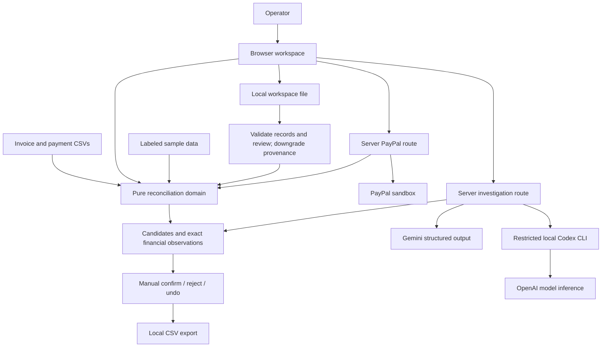
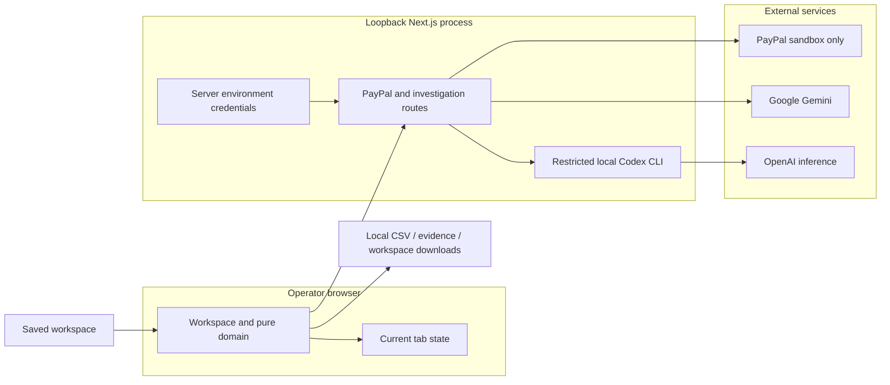

# Paper Ledger | Architecture and Judge Setup

**Source: [Smokeybear10/paper-ledger](https://github.com/Smokeybear10/paper-ledger)**

Paper Ledger reconciles invoice balances with PayPal receipt evidence and explicit human review.
The clean source-package build and a public-npm Codex investigation → manual decision → evidence brief flow have been verified. Devpost registration is confirmed; authenticated PayPal and Gemini checks remain unverified.
Updated November 5, 2026.

Judge entry points: [clean-machine setup](#judge-quick-start), [sample review](#try-the-sample-and-review-workflow), [submission draft](#6-competition-entry-draft), [source-package plan](#public-source-package-plan).

## Judge quick start

Clone the public repository below, or extract the prepared archive and skip the git clone line. The 27-file ZIP was extracted into a fresh directory and passed npm ci, build, typecheck and start using macOS, Node.js 24.6.0 and npm 11.5.1. The commands below use a macOS/Linux shell; other operating systems have not been rehearsed.

```sh
git clone https://github.com/Smokeybear10/paper-ledger.git paypal-reconciliation
cd paypal-reconciliation
npm ci
cp .env.example .env.local
npm run build
npm run start
```

Open [http://127.0.0.1:3107/](http://127.0.0.1:3107/). Keep that exact origin; do not change the port or expose it through a public tunnel. The server boundary permits local browser requests on port 3107. Stop the server with Ctrl+C. `npm run dev` is the development alternative; `npm run typecheck` is available after Next has generated its build types.

Blank credentials support the synthetic sample, CSV import, exact matching, manual review, CSV/HTML export and local workspace save/open. They do not simulate a successful PayPal or AI call. There is no database, migration, cloud account or background service to initialize.

### Try the sample and review workflow

1. Choose **Load sample ledger**. The six invoices and six payment/event rows are explicitly synthetic and initially unreviewed. **Investigations** opens a receipt-centered queue. **Collection totals** initially reports four eligible unallocated receipts / $2,090 original gross, $325 pending and −$60 signed adjustments. The $500 receipt shared by two candidate invoices is counted once.
2. Open **INV-4107**. In **Receipt comparison**, inspect PAY701 against INV-4107 and INV-4108: both invoices are $500 for Morgan Studio / C07; the receipt has no structured invoice ID. Its $500 gross, $17.94 fee cost and $482.06 net remain separate. Switching candidate invoices retains only a currently related receipt.
3. If AI is not configured, continue with manual review in step 4; no sample model response is invented. With an AI provider enabled, expand **Preview a redacted excerpt** in the review rail. Choose **Use displayed remittance for review**, inspect/redact the text and named provider destination, acknowledge the evidence, then choose **Investigate with AI**. The sample note says “Balance for invoice forty-one-oh-seven. Thanks.” A supported result must quote supplied text and cite supplied IDs; it remains a hypothesis. The UI must show an unavailable/error state if the actual request fails.
4. Expand **Add a decision note**, enter a reason, and inspect the allocation preview. Confirm PAY701 for INV-4107. Confirmed gross becomes $500, its fee remains separate, and INV-4108 loses the competing receipt. The human action, note, timestamp and revisions are recorded. **Undo this invoice's review** releases the receipt and removes frozen AI evidence for that decision.
5. Inspect INV-4105's unreviewed $600 partial candidate against $960 due, INV-4106's $325 pending event, and INV-4109's $240 original receipt with a −$60 linked refund. Pending receipts cannot be confirmed; the refund prevents a simple covered conclusion. **Receipts** also shows unallocated pending/refund/unsupported events.
6. Choose **Download evidence brief** for a reviewed case and open the downloaded standalone HTML. It separates deterministic amounts, current review, source provenance and any validated historical pre-decision AI evidence. **Export review** downloads invoice, payment/event and decision CSV rows; suggestions do not contribute to confirmed totals.
7. Choose **Workspace → Save workspace**. After refresh, choose **Workspace**, open the saved JSON, inspect the counts/date and choose **Restore records and decisions**. Records, manual decisions, applied notes and revisions restore; sources become unverified file evidence. AI responses and frozen evidence do not restore. Save the evidence HTML separately when that analysis must be retained.
8. To exercise CSV imports, use `public/samples/invoices.csv` and `public/samples/payments.csv` through **Import files**. Select the collection, check column mapping, validate the preview and explicitly replace it. Each replacement preserves the other collection and clears review/AI state. Invalid files leave current work intact.

The authenticated PayPal path must also traverse normalization, candidate evidence, manual review and export before the entry is described as fully verified. A successful OAuth token or isolated record lookup alone does not establish that end-to-end claim.

### Enable one AI provider

The clean-package browser rehearsal used this public npm CLI build. Install it and sign in on the judge's own machine:

```sh
npm install --global @openai/codex@0.166.0-alpha.5.1
codex --version
codex login
```

Then edit these existing `.env.local` entries and restart Paper Ledger:

```dotenv
AI_PROVIDER=codex
CODEX_BIN=codex
```

The bridge was verified with that CLI version; it uses specific non-interactive capability flags, so a different CLI version must be checked before promising compatibility. If `codex` is not on the Node server's PATH, set CODEX_BIN to its local absolute executable path. Do not copy the developer's path or authentication files. CODEX_MODEL is optional; when unset, the response identifies `codex-cli-default`, not a proven underlying model ID. Use the actual provider/model label from the recorded run in the final submission.

The normal Codex sign-in flow requires an account with model access and available usage. Paper Ledger does not distribute an authenticated account. Installation and sign-in behavior are described in the [official OpenAI Codex CLI documentation](https://learn.chatgpt.com/docs/codex/cli).

The portable alternative is the implemented Gemini adapter:

```dotenv
AI_PROVIDER=gemini
GEMINI_API_KEY=your_local_key
GEMINI_MODEL=gemini-3.5-flash-lite
```

A working key, model access and quota are required. The Gemini network path has not yet been verified against a real account; the default model name is configuration, not a claim of access. Do not publish `.env.local`, API keys or CLI credentials. Configuration badges mean configured, not authenticated or successfully evaluated.

### Enable PayPal sandbox reads

Edit the existing `.env.local` entries, using the same sandbox merchant that owns the record to be inspected, then restart:

```dotenv
PAYPAL_CLIENT_ID=your_sandbox_app_client_id
PAYPAL_CLIENT_SECRET=your_sandbox_app_secret
```

Use **PayPal sandbox → Known capture** with an authorized capture ID, or **Reporting window** with explicit UTC dates. The reporting window is at most 31 days and 1,000 records; reporting can lag recent activity. A permission denial is a real connector error. The app never substitutes sample data for an unsuccessful API call.

The app reads existing sandbox transactions; it does not create a checkout or money movement to seed an account. Prepare one authorized completed USD capture outside the app, and one invoice CSV row whose amount and reference reflect the intended demonstration. Keep that invoice's file provenance distinct from the authenticated receipt.

A returned source preview requires **Apply sandbox replacement**. Applying it replaces the entire payment collection and clears previous decisions/AI, while retaining invoices. Inspect **Sources** for requested range, observed range, filters, account identity if returned, and fetch time. One capture is one observation; a fully fetched query window is not complete account history.

## 1. System overview

A local Next.js application keeps the current invoice/payment dataset and review decisions in browser memory.
The operator can explicitly save a versioned local workspace file and preview a validated restore. No automatic or server-side ledger storage is used.
A pure TypeScript domain module validates money, normalizes rows, proposes candidates and applies reviewed allocations.
Two server routes make bounded read-only PayPal sandbox calls and structured AI investigations through Gemini or a restricted authenticated local Codex CLI.
Credentials remain in the server environment. No database, account system or background workers are required.



Boundaries:
- Files, network responses and model output are untrusted.
- Provider provenance applies only to returned API observations.
- Model proposals and human confirmation do not upgrade provenance.
- Only confirmed allocations affect confirmed settlement totals.

## 2. Components

These are the implemented component locations.

| Component | Purpose | Owns | Depends on | Lives in |
|---|---|---|---|---|
| App shell | Server-rendered entry and configuration booleans | Initial shell; no secrets in props | Workspace | app/page.tsx, app/layout.tsx |
| Workspace | Import preview, ledger, selected case and review | Current dataset, revisions, active requests and decisions | Domain and server routes | app/workspace.tsx |
| Product styles | Ledger, evidence and responsive states | Visual presentation | App shell and workspace | app/globals.css |
| Reconciliation domain | Types/schemas, CSV normalization, money, candidates, review and export | Pure financial and state transitions | Zod and CSV parser | lib/reconciliation.ts |
| Shared contracts | Canonical types and boundary schemas | Validated data shapes | Zod | lib/contracts.ts |
| Local server boundary | Enforce loopback Host/Origin, bounded JSON and sanitized errors | Shared request policy for both routes | Native Web APIs | lib/server-boundary.ts |
| Sample ledger | Reproducible, explicitly synthetic cases | Fixture records | Domain types | lib/sample-data.ts |
| PayPal adapter | OAuth, capture/report reads, event mapping and response normalization | Server token cache and request state | PayPal sandbox; domain schemas | app/api/paypal/route.ts |
| AI adapter | Recompute evidence, select provider, validate semantic proposals | Server model request and output validation | Gemini or local Codex bridge; domain schemas | app/api/investigate/route.ts |
| Codex bridge | Bounded text-only local CLI invocation | Private temporary files, process cancellation, concurrency and output limits | Installed authenticated Codex CLI | lib/codex-inference.ts |
| Investigation desk | Receipt-centered exception grouping and exact decision previews | Derived findings and noncommitting allocation simulation | Validated domain | lib/case-intelligence.ts, app/investigation-desk.tsx |
| Candidate comparison | Exact receipt facts and actual invoice relationships | Presentation of gross/reference/customer/eligibility and live selection | Reconciliation result and shared contracts | app/case-comparison.tsx |
| Evidence brief | Current and frozen pre-decision evidence with review versions | Validated capture/pruning and escaped standalone HTML | Domain and shared contracts | lib/evidence-brief.ts |
| Workspace file | Bounded versioned save/restore of records and manual review | Validation, financial/review invariants and unverified restored sources | Shared schemas and reconciliation domain | lib/workspace-file.ts |

Use a small number of cohesive functions/modules; split a large domain module only when its concerns warrant it.
Avoid a second backend, generic agent framework or speculative service classes.

## 3. Request lifecycles

### Import and reconciliation — target: under 1 second for bounded collections

```mermaid
sequenceDiagram
  participant U as Operator
  participant W as Workspace
  participant D as Pure domain
  U->>W: Select CSV and mapping
  W->>D: Validate bytes, headers, rows and money
  D-->>W: Preview or row errors
  U->>W: Apply collection replacement
  W->>W: Increment dataset revision; clear decisions and AI
  W->>D: Build candidates and exact observations
  D-->>W: Ledger and unresolved exceptions
```

Invoice replacement preserves payments; payment replacement preserves invoices.
There is one active payment source. CSV and sandbox imports replace it rather than append.
Invalid/conflicting imports preserve the current dataset.
Source rows and unsupported-event counts remain inspectable.

### Selection, filtering and review — target: under 100ms locally

```mermaid
sequenceDiagram
  participant U as Operator
  participant W as Workspace
  participant D as Pure domain
  U->>W: Select or filter a result
  W->>D: Read local candidates and observations
  D-->>W: Evidence panel
  U->>W: Confirm / reject / undo
  W->>D: Validate available receipts and apply decision
  D-->>W: New confirmed allocations and candidate availability
  W->>W: Increment review revision; invalidate old analysis
```

The investigation view uses a filtered work queue beside a selected-case comparison and review rail. Candidate navigation rechecks the live receipt/invoice relationship, preserves only related receipt context, aligns selected payment IDs with eligibility and clears stale analysis/consent.

One receipt cannot be confirmed for two invoices.
Suggested coverage and confirmed allocations are different fields.
Fees do not reduce invoice gross coverage.
Refunded or reversed receipts remain explicit exceptions.
Render a bounded page of ledger rows; do not put network requests on this path.

### AI investigation — immediate progress, bounded remote request

```mermaid
sequenceDiagram
  participant U as Operator
  participant W as Workspace
  participant A as Investigation route
  participant G as Selected AI provider
  U->>W: Preview redacted excerpt and investigate
  W->>W: Capture request ID and case fingerprint
  W->>A: Validated case, candidates and excerpt
  A->>A: Enforce local request boundary and recompute facts
  A->>G: Bounded structured semantic request; no payment tools
  G-->>A: Completed structured response or named error
  A->>A: Validate schema, candidate IDs, citations and literal quote
  A-->>W: Semantic proposal and deterministic observation IDs
  W->>W: Recompute current fingerprint and request identity
  alt Current request and case
    W-->>U: Reviewable interpretation with cited evidence
  else Changed data, decision, selection or excerpt
    W->>W: Discard stale result
  end
```

The fingerprint covers dataset/review revisions, selected case, candidate and receipt IDs, allocations and previewed excerpt.
A newer request ID invalidates an older request even if its content matches.
Aborting a request is best effort; reducer acceptance checks enforce correctness.
Financial amounts displayed beside a proposal come from deterministic code.
The model proposes an interpreted reference and exact quoted evidence, never an allocation action.
Gemini requests use store:false. Local Codex uses ephemeral CLI execution with command execution, browser/computer access, connectors, hooks and delegation disabled, and no inherited user configuration. The same quote/ID/arithmetic validation follows both providers. Codex requests are serialized, capped at 60 seconds and 512 KB of output; cancellation waits for the child to close before releasing the slot. No provider-side zero-retention claim is made.
A validated proposal can be frozen with the actual subsequent decision timestamp and dataset/review revision. Frozen evidence is labeled historical, is removed on undo/source replacement, and is exported separately from current AI analysis.

### Sandbox import — immediate progress, complete bounded result before replacement

```mermaid
sequenceDiagram
  participant U as Operator
  participant W as Workspace
  participant P as PayPal route
  participant S as PayPal sandbox
  U->>W: Request known capture or bounded reporting window
  W->>P: Operation and typed parameters; request ID
  P->>P: Enforce local request boundary
  P->>S: OAuth token if needed
  loop Each required reporting page, or one capture lookup
    P->>S: Fixed read-only sandbox endpoint
    S-->>P: Provider response
    P->>P: Validate and normalize; check limits and totals
  end
  P-->>W: Sanitized records, provenance and coverage
  W->>W: Reject stale response after dataset change
  W-->>U: Replacement preview
  U->>W: Apply source replacement
  W->>W: Clear decisions and old AI; run same reconciliation domain
```

Capture lookup replaces the active payment collection with that record; it does not append a duplicate.
Reporting uses explicit dates, all pages and balance_affecting_records_only=Y.
Failed, inconsistent or over-limit requests do not replace the current collection.
The reporting adapter recognizes completed incoming USD T0006 receipts; the capture adapter uses its separate CAPTURE mapping. Unsupported events remain in the summary. These mappings have contract checks; actual merchant access is not established by those checks.
A completely fetched query window is not lifetime account coverage.

### Export — local operation

Export confirmed allocations, separately named suggestions, source IDs, fee/null state and coverage.
Escape user-controlled formula prefixes and quote CSV fields correctly.
No export request reaches a provider or accounting system.

### Save and restore — local files

The Workspace dialog downloads a versioned JSON file containing normalized records, original row fields, manual decisions/notes, revisions and selection. It excludes AI responses, frozen model evidence, credentials and active requests. The separate evidence brief preserves the model analysis from a reviewed decision.

Opening a workspace validates actual UTF-8 bytes (16 MiB maximum), schemas, calendar dates, exact money, unique provider observations and all manual allocation/rejection rules. A preview shows record/decision counts before explicit replacement. Invalid files preserve the active dataset and draft notes. Restored source labels identify a workspace file; provider verification, fetched-account identity and original query-completeness claims are discarded. Observed ranges are derived again from the restored records. Saved decisions are operator-managed claims, not an authenticated audit log.

Restore preserves validated dataset/review revisions and decision timestamps, invalidates all pending request identities and file reads, synchronously replaces the current snapshot, and clears current/frozen AI. A late response cannot apply even if the restored revisions match an earlier workspace.

## 4. State topology

| State | Logical home | Physical home | Lifetime | Failure mode |
|---|---|---|---|---|
| Invoices and payments | Browser memory | Workspace dataset state | Current tab | Reopen an explicitly saved workspace after refresh |
| Original source evidence | Browser memory | Normalized record provenance | Dataset | Unverified/missing fields remain explicit |
| Dataset revision | Browser memory | Workspace revision counter | Current tab | Old request/result cannot apply |
| Confirmations and rejections | Browser memory | Review state keyed by record IDs | Dataset | Cleared on source replacement |
| Review revision | Browser memory | Review state counter | Dataset | Pending AI invalidated after review/undo |
| Selection/filter/page | Browser memory | Workspace view state | Current tab | Fall back to all results |
| Redacted excerpt | Browser memory | Selected case state | Current case | AI unavailable without allowed evidence |
| Active request and fingerprint | Browser memory | Request context | Pending request | Stale response discarded |
| AI proposal | Browser memory | Current case result | Until case context changes | Keep deterministic evidence |
| PayPal credentials | Server configuration | Environment variables | Process configuration | Connector unavailable |
| PayPal OAuth token | Server memory | Private route-module cache | Until provider expiry | Refresh once; show named error |
| AI provider/model configuration | Server configuration | Environment variables | Process configuration | AI unavailable or named provider error |
| Codex authentication | Local CLI credential manager | Operator-managed CLI session | Account/session lifetime | Sign-in or model access required |
| Sample ledger | Versioned source | lib/sample-data.ts | Build | Import a file instead |
| Review export | Operator filesystem | Downloaded CSV or evidence HTML | Operator-managed | Not an authenticated audit log |
| Saved workspace | Operator filesystem | Explicit JSON download | Operator-managed | Invalid files cannot replace current work; AI and verified-source claims do not restore |

No localStorage, cookie ledger, server database or durable audit-log claim is introduced.
Every monetary field is integer USD minor units, with signed gross/net and signed fee cost.
Validate safe integer bounds at normalization and aggregation.

## 5. Deployment topology



Local origin: http://127.0.0.1:3107. This fixed loopback origin is also enforced by the server request boundary.
Both development and local production processes bind to loopback.
Credential-backed routes enforce allowlisted Host, exact Origin, JSON content type and actual body limits.
Construct fixed provider paths server-side; reject redirects and caller-supplied endpoints.
Do not return credentials, access tokens, raw provider errors or whole account payloads.
Do not log source memos, customer records or model request contents.

Initial judge path: reproducible local build plus the permitted demonstration video.
The remaining authenticated PayPal and judge-access checks are listed in the submission handoff below.
Public hosting is not performed by this plan. Before publication, review authentication, cost limits and judge access.
No production deployment or rollback has occurred.

## 6. Competition entry draft

**Project:** Paper Ledger

**Short description:** Investigate PayPal receipt mismatches with source records, cited AI reference interpretation and explicit human review.

**Description:**

Paper Ledger helps a small merchant reconcile an invoice spreadsheet against PayPal receipts. A compact work queue groups competing invoice candidates, partial coverage, pending events and linked refunds. A comparison table shows the receipt beside its candidate invoices, including amount, customer key, reference and eligibility. Gross receipts, processing fees and net amounts stay separate.

For ambiguous payment notes, the operator previews a bounded evidence packet and a redacted excerpt before sending it to the selected AI provider. The model can propose a reference interpretation with a literal quote and supplied citations. Exact arithmetic and allocation checks remain deterministic; only the operator can confirm or reject an association. The preview shows which competing candidates will lose the receipt.

A reviewed case can be downloaded as a standalone evidence brief containing source provenance, the validated hypothesis when available, and the later manual decision as separate versioned evidence. CSV export includes unresolved exceptions. A local workspace file preserves records and manual review without a server database.

**Current limitation:** This prototype supports one local operator and USD records. Its PayPal sandbox read adapters are implemented, but authenticated merchant verification is still pending. The sample ledger is synthetic. No customer adoption, measured time savings, accounting certification, production integration or prize outcome is claimed.

Update the limitation only after the corresponding authenticated workflow is actually verified; the description is a reviewable draft, not an already-published entry.

### Tools and AI disclosure

| Tool | Actual role | Verification boundary |
|---|---|---|
| PayPal sandbox OAuth, Payments v2 capture details and Transaction Search v1 | Read-only provider observations with bounded source coverage | Implemented with contract/mock checks; authenticated merchant data remains unverified |
| OpenAI via Codex CLI 0.166.0-alpha.5.1 | Runtime text-only reference interpretation with a closed JSON schema | Public npm installation and the clean packaged-app browser flow passed using normal existing CLI authentication; no authentication was copied into the package |
| Google Gemini | Configurable alternative runtime provider through the Interactions API | Implemented; real-account/model access not yet verified |
| TypeScript, Next.js 16.4.5, React 19.3.1 | Local browser workspace and server adapters | Versions pinned in package files |
| Zod 4.6.7 and Papa Parse 5.7.0 | Boundary validation and CSV parsing | Financial results come from deterministic code |
| Tailwind CSS 4.3.4 and local Instrument Sans | Application styling and bundled fonts | No generated imagery or runtime design service |

The clean-package browser rehearsal confirmed PAY701 → INV-4107 with an operator note. The downloaded HTML retained the actual model quote and later decision while marking both source collections as not provider-verified; the CSV retained the note. Existing normal CLI authentication was used, without copying authentication into the app or archive.

The AI receives only selected-case invoice/receipt facts, anonymous customer groups, source IDs, deterministic observations and the approved excerpt. The excerpt is transmitted exactly as previewed; the operator must redact it. Names/email fields and whole source rows are excluded from structured evidence. The model has no payment tools and cannot change allocations or money. The Codex bridge disables tool capabilities; neither provider is described as operating an autonomous payment agent. Model usage/account limits still apply.

### Two-and-a-half-minute demo plan

This is a recording script, not a completed video. Record real successful API/model flows and keep synthetic records visibly labeled. Prepare the actual sandbox invoice/capture and provider configuration before recording; do not spend the video on account setup.

| Time | Screen and narration |
|---|---|
| 0:00–0:12 | State the audience and problem: a merchant has invoice and PayPal rows, and equal amounts do not identify an invoice. Show the real work queue. |
| 0:12–0:40 | Fetch the prepared authorized sandbox record, inspect source/coverage, apply it, compare against the prepared invoice, confirm and export. Show only actual returned data as provider-verified. |
| 0:40–0:55 | Explicitly switch to **Load sample ledger**. Point out the synthetic label, the two $500 invoices and one shared PAY701 receipt. |
| 0:55–1:35 | In the comparison and adjacent review rail, preview the note, identify the provider destination and run the actual model. Show its literal quote/citations and the separate deterministic gross/fee/net. If an edit shortens waiting, label that edit; do not imply a measured response time. |
| 1:35–1:58 | Add a note, show the allocation preview and confirm INV-4107. Show INV-4108 lose PAY701; the receipt cannot cover both. |
| 1:58–2:15 | Briefly inspect partial, pending and refund cases. Pending is excluded from settled gross; a linked refund remains an exception. |
| 2:15–2:30 | Open the evidence HTML showing the hypothesis, later human decision and provenance. Close with the USD/single-operator/local-file scope. |

### Remaining submission artifacts and access

The [official overview](https://paypalaihackathon.devpost.com/) requires a working build, public open-source code with a license, a tools/AI explanation and a publicly visible YouTube video under three minutes. Clear repository setup instructions can satisfy demo access without public hosting. The submission deadline is November 12, 2026 at noon Pacific / 3pm Eastern. [Official rules](https://paypalaihackathon.devpost.com/rules)

| Deliverable | Current evidence / required completion |
|---|---|
| Working local build | Fresh 27-file ZIP extraction, npm ci/build/typecheck/start passed; blank-provider 503 and cross-origin 403 responses were also verified |
| Meaningful authenticated PayPal use | Still needs one authorized merchant record through normalization, review and export |
| Meaningful runtime AI | Clean packaged-app browser flow passed using the public npm Codex CLI; use the actual provider/model configuration in the final recording |
| Public source URL | [Smokeybear10/paper-ledger](https://github.com/Smokeybear10/paper-ledger) · MIT · [Judge setup](https://github.com/Smokeybear10/paper-ledger/blob/main/ARCHITECTURE.md#judge-quick-start) |
| Public demo video URL | Not recorded by this artifact; record the script above and upload the final English video publicly to YouTube |
| Entry text and tools disclosure | Drafted above; reconcile statements with the final recorded build before entering the form |
| Judge access through December 15 | Final instructions must make the app and required provider access usable through the end of judging; no developer credentials are bundled in source |
| Registration | Confirmed: Devpost directly displayed “You're registered for this hackathon” |
| Devpost project entry | Not created; the description above is a local draft |
| Final submission | Not confirmed; complete the entry with public source/video links and verify the final form receipt |

The source license is already MIT in `LICENSE`. A public source repository and working synthetic demo do not establish authenticated PayPal functionality or final submission.

### Public source package plan

The public source release uses this 27-file allowlist. Its source ZIP was rehearsed after clean extraction; archive root: `paypal-reconciliation/`.

```text
paypal-reconciliation/
  app/                       # all application .ts/.tsx/.css files
  lib/                       # domain, contracts, adapters and local-file modules
  public/samples/
    invoices.csv             # synthetic fixture
    payments.csv             # synthetic fixture
  .env.example               # blank credentials only
  .gitignore
  ARCHITECTURE.md             # judge setup, contracts and entry draft
  LICENSE
  next-env.d.ts
  package.json
  package-lock.json
  postcss.config.mjs
  tsconfig.json
```

Exclude `.env.local`, every other populated `.env*`, `.next/`, `node_modules/`, `*.tsbuildinfo`, `.git/`, `.gstack/`, OS files, CLI authentication/configuration, saved user workspaces, downloaded evidence/CSV files, recordings and agent review artifacts. Exclude `AGENTS.md`, `DESIGN.md`, `public/design/` and the generated `public/architecture/` snapshot: they are local planning material, not runtime dependencies. This document preserves the current implementation contracts without those duplicate artifacts. Never copy an absolute executable path from the developer machine into `.env.example` or public instructions.

Clean extraction, installation/build and the public-CLI browser workflow have passed without packaged credentials. For each release, refresh the archive if source changes, recheck its entries for secrets/private paths and MIT license inclusion, and record the final archive hash or commit. Link directly to this file's judge setup section from the submission. The video must show the same released source version.

## 7. Decision log

Initial contracts were selected November 4, 2026; local workspace, provider and workbench refinements followed November 5.

- **One local Next.js application** — matches Thomas’s stack and supplies built-in server route handlers; separate FastAPI service adds no required capability.
- **Browser-memory financial workspace** — keeps active ledgers off the server. The November 5 local refinement adds explicit user-managed save/reopen files, preserving manual review while downgrading restored provider provenance.
- **One payment source at a time** — explicit replacement prevents CSV/reporting/capture double counting without a merge-resolution product.
- **Exact bounded integer money** — prevents floating-point settlement errors; no FX conversion or arbitrary-precision feature is needed within enforced limits.
- **Gross coverage, separate fees** — a fully paid invoice is not short because the merchant paid a processing fee.
- **Confirmed versus suggested allocations** — only explicit user decisions affect confirmed totals.
- **Conservative event eligibility** — only verified incoming completed receipt mappings are candidates; unknown events stay visible.
- **Closed semantic AI response** — reference interpretation and quoted evidence add language understanding; deterministic code owns financial claims.
- **Request identity and case fingerprint** — cancellation alone cannot prevent a late result from using obsolete allocations.
- **Fixed sandbox/provider endpoints** — browser parameters cannot turn the server into a general authenticated proxy.
- **Native provider fetch** — avoids a model SDK or agent framework where the two request adapters suffice.
- **Verification without a new test suite** — user instruction forbids adding tests absent a request or existing suite; use one-off assertions and browser/integration evidence.
- **No hosting before verification** — a local request boundary is not production authorization.

## 8. Out of scope

- Live payments, refunds, payouts and invoice emails: the entry reads and reconciles sandbox evidence.
- Third-party merchant onboarding: partner access is not established.
- Multi-tenant accounts and durable ledgers: not needed for the approved current-tab workflow.
- FX and non-USD settlement: conversion would add independent accounting semantics.
- Splitting one receipt among invoices: prevents ambiguous allocation complexity.
- Mixed-source merging: explicit source replacement is the approved simpler boundary.
- Model-initiated allocation or payment actions: human review owns decisions.
- Whole-ledger AI upload or general chat: only bounded selected-case evidence belongs in investigation.
- New automated test-suite scaffolding: not requested; appropriate verification remains required.
- Public hosting and production-account integration: the judging path is a local build. Source publication, video and final submission are release deliverables tracked above.

Status: product/engineering contracts approved; clean-package/public-CLI rehearsal and Devpost registration verified. Public source is linked above. Authenticated PayPal access, public video and final submission remain unverified.

